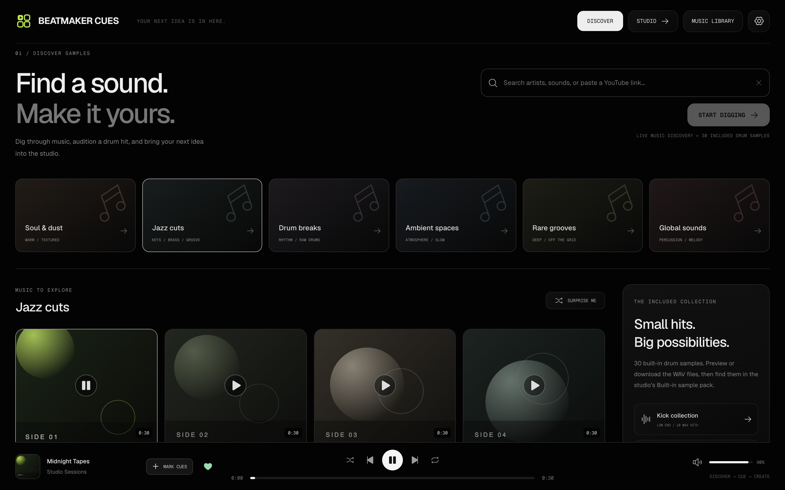
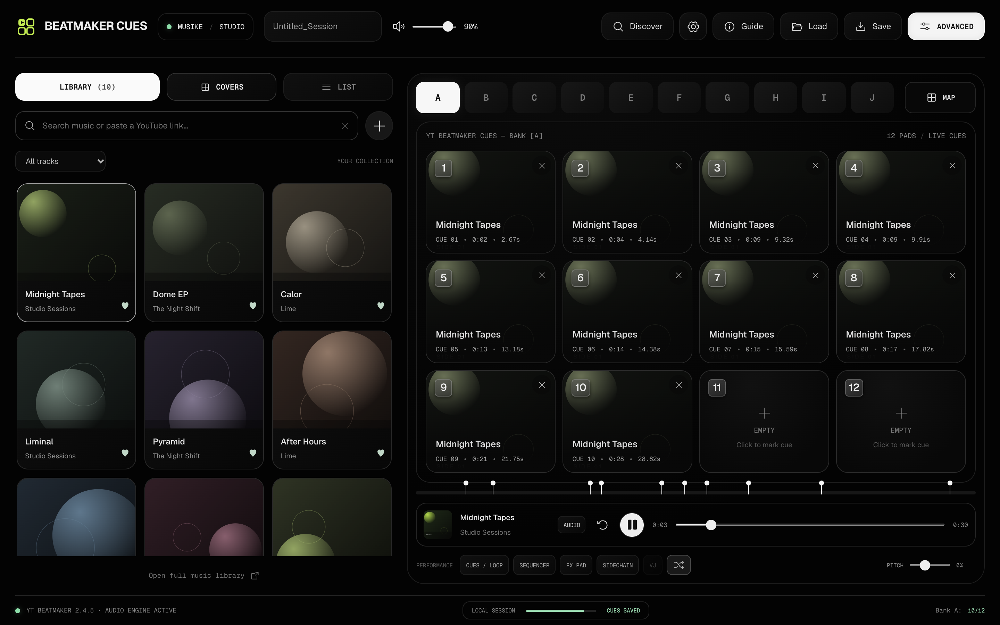
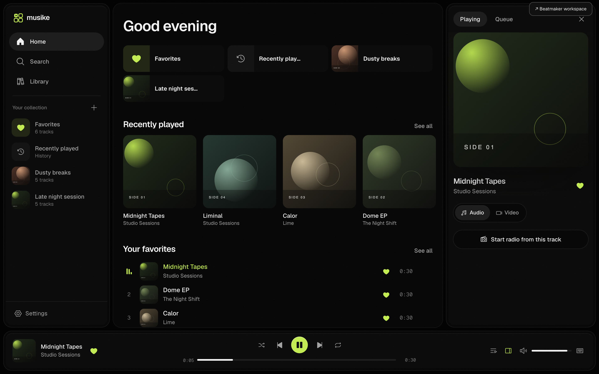
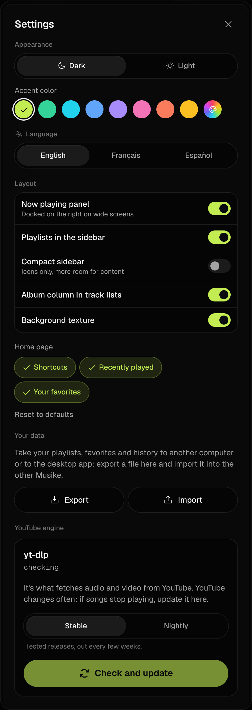

# YT Beatmaker Cues Desktop

**Your music. Your instrument.**

A standalone macOS music and beatmaking app combining [Musike](https://github.com/Ernani1234/musike)'s music player with the original **YT Beatmaker Cues 2.4.5** engine. A dark, hardware-inspired workspace puts your library, cue banks and performance tools in one window.

**[Download v1.0.0](https://github.com/jrucho/YT-Beatmaker-Cues-Desktop/releases/tag/v1.0.0)** · [Usage guide](docs/beatmaker-desktop.md) · [Release notes](CHANGELOG.md)

<p align="center">
  <a href="docs/screenshots/discover-samples.png"></a>
</p>

| Studio and cue timeline | Music library |
| :---: | :---: |
| <a href="docs/screenshots/studio.png"></a> | <a href="docs/screenshots/library.png"></a> |

<p align="center">
  <a href="docs/screenshots/settings.png"></a>
</p>

## Install on macOS

Requires macOS 12 or newer.

| Mac | Download |
| --- | --- |
| Apple Silicon — M1 and newer | [YT-Beatmaker-Cues-Desktop-1.0.0-macOS-arm64.dmg](https://github.com/jrucho/YT-Beatmaker-Cues-Desktop/releases/download/v1.0.0/YT-Beatmaker-Cues-Desktop-1.0.0-macOS-arm64.dmg) |
| Intel | [YT-Beatmaker-Cues-Desktop-1.0.0-macOS-x64.dmg](https://github.com/jrucho/YT-Beatmaker-Cues-Desktop/releases/download/v1.0.0/YT-Beatmaker-Cues-Desktop-1.0.0-macOS-x64.dmg) |

Open the DMG and drag **YT Beatmaker Cues Desktop** to **Applications**. The first launch downloads yt-dlp, Deno and FFmpeg for playback.

The app is ad-hoc signed and is **not Apple-notarized**. If macOS blocks it, attempt to open it once, then use **System Settings → Privacy & Security → Open Anyway**. If macOS reports that the app is damaged, remove its download quarantine flag:

```sh
xattr -dr com.apple.quarantine "/Applications/YT Beatmaker Cues Desktop.app"
```

Personal data lives in `~/Library/Application Support/YT Beatmaker Cues Desktop`, separate from an existing Musike installation.

## What's inside

- **Discover Samples:** the opening page, with searchable music crates, live previews, favorites and one-click loading into the studio.
- **Included drum banks:** 30 real kick, snare and hi-hat WAV files with working preview and download actions, available without an internet connection in the desktop app.
- **Music discovery:** search YouTube Music, paste a YouTube link, browse the full Musike catalog, and keep favorites and playlists.
- **Cue workspace:** 12 pads, A–J banks per track, keyboard triggering, Shift-click cue replacement, and local autosave.
- **Performance:** original Pitch / Speed / Speed HD, region loops, sequencer, FX Pad, sidechain, audio/video loopers and MIDI controls.
- **Video:** audio/video switching, VJ tools and a separate projection window for the current player.
- **Optional AI stems:** the original locally running stems engine with a separately downloaded, verified model.
- **Sessions:** export and import `.beatmaker.json` files containing track references and cue banks.
- **Reference-inspired interface:** near-black surfaces, fine borders, white active controls, a cover library and a four-column pad grid.

## Quick start

1. Start on **Discover Samples**. Choose a music category or search, preview a track and click **Load in Studio**. The included kick, snare and hi-hat collections also have playable, downloadable WAV hits.
2. In the studio, click an empty pad to mark the current time. Click an assigned pad to trigger it; **Shift-click** to replace it.
3. Use **1–9 / 0** for the first ten cues and the **A–J** bank buttons for more cue sets.
4. **Cues / Loop** toggles the compact performance bar; click it again to hide it, or to rebuild it after **Advanced** removes it. Open **Sequencer**, **FX Pad**, **Sidechain**, **VJ** or **Advanced** for the original Beatmaker tools. See [studio toolbars and panels](docs/beatmaker-desktop.md#studio-toolbars-and-panels) for what each one does.
5. Use **Save / Load** to move a cue session between installations.

See the [detailed guide](docs/beatmaker-desktop.md) for architecture, shortcuts and session-format details.

### Control verification

Controls are connected to real playback, files, library APIs or the original engine. **MAP** opens MIDI mappings. Controls that require a loaded track or a video source are disabled until one is ready. Unsupported Chrome-tab options and studio-inapplicable appearance settings are not offered. See the [control audit](docs/control-audit.md) for verified actions and hardware-dependent checks.

## Version 1.0 scope

macOS installers are provided for Apple Silicon and Intel. The inherited web, Windows, Linux and mobile source remains available, but those platforms are not release downloads for this version.

- One music player is integrated. Chrome's multi-tab VJ feeds are not multiple desktop decks.
- Session exports contain track metadata and cue banks, not recorded audio, the AI model or every engine preference.
- Hardware MIDI, external audio routing, projector output and full AI inference need testing with the intended devices and model installed.
- Core playback and cue checks use a deterministic HTTP Range audio fixture; the packaged Apple Silicon app has also been launch-tested. Intel packages have been built and signature-checked, but not run on Intel hardware.

## Build from source

Requires **Node.js 22.19+** (Node 24 recommended) and **pnpm 10**. Build the macOS installers on a Mac.

```sh
git clone https://github.com/jrucho/YT-Beatmaker-Cues-Desktop.git
cd YT-Beatmaker-Cues-Desktop
pnpm install --frozen-lockfile
pnpm typecheck
pnpm installer:mac
```

Installers are collected in `release/`. To run the desktop app during development, use `pnpm desktop`. For a browser preview: `pnpm build && pnpm start`, then open `http://localhost:4180/?workspace=beatmaker`.

Run the automated application checks after building:

```sh
pnpm exec playwright install chromium
pnpm test:app
```

The checks use an isolated local library and deterministic audio/video fixtures. Your personal library is not used.

## Project structure

| Folder | Contents |
| --- | --- |
| `web/src/beatmaker/` | Workspace UI and app integration adapter |
| `YTbeatmakercues/` | Supplied original extension, version 2.4.5 |
| `desktop/` | Electron shell, packaging and installer collection |
| `server/` | Musike catalog, stream proxy and local library |
| `web/` | React player and full music browser |
| `mobile/` | Inherited mobile source |

Internal `@musike/*` workspace names are retained for compatibility. The desktop application and this project are versioned independently of the extension engine.

## Credits and license

Maintained by [jrucho](https://github.com/jrucho).

- Built on [Musike by Ernani Neto](https://github.com/Ernani1234/musike), MIT. The original [license](LICENSE) and [upstream documentation](docs/upstream-musike.md) are preserved.
- Includes the supplied YT Beatmaker Cues 2.4.5 source and sample/worklet assets.
- Uses Signalsmith Stretch and ONNX Runtime Web; see [third-party notices](YTbeatmakercues/THIRD_PARTY_NOTICES.md). The optional HT-Demucs model is downloaded separately.

For personal and educational use. Playback depends on YouTube availability and may be affected by upstream changes. Respect YouTube's terms and artists' rights; see the [upstream legal notice](docs/upstream-musike.md#legal-notice).
