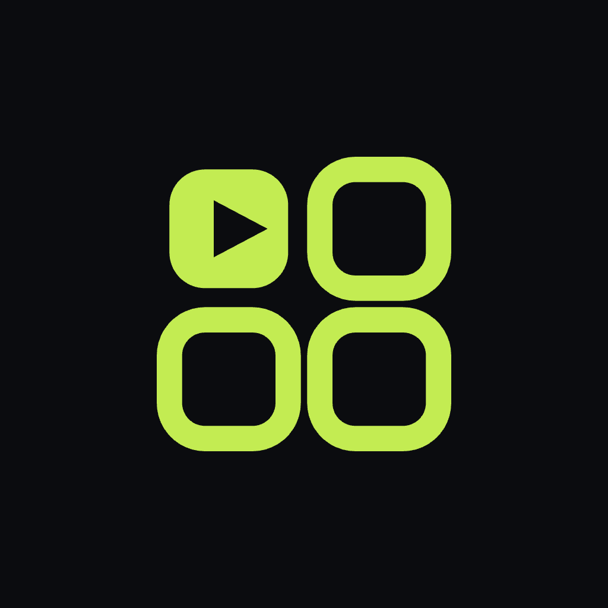
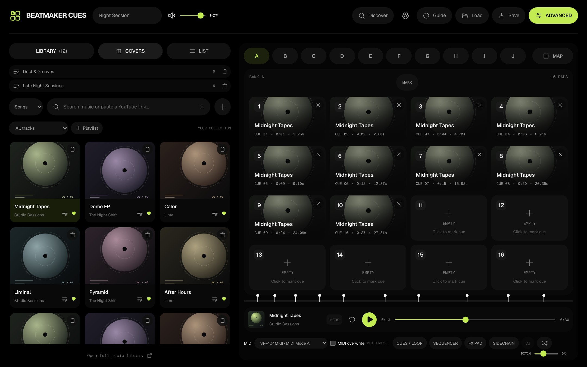
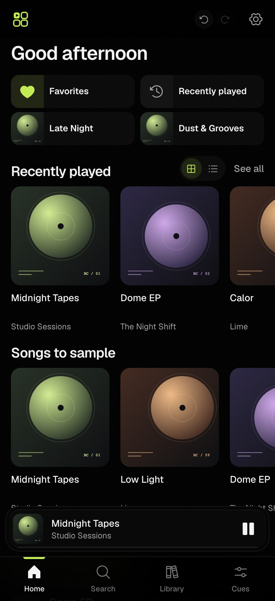
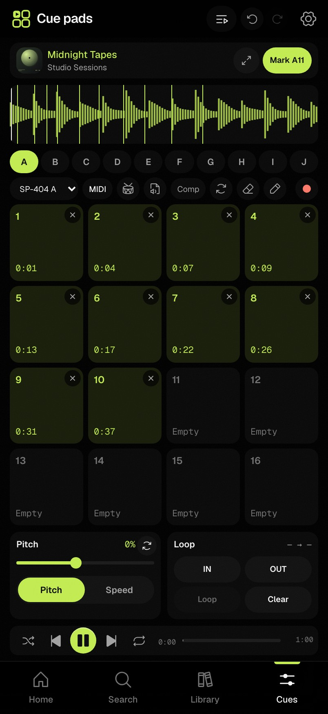

<p align="center">
  
</p>
<h1 align="center">Beatmaker Cues</h1>
<p align="center">
  <strong>Find a sound. Make it yours.</strong><br>
  Discover tracks, mark cues, and play your music like an instrument.
</p>

## Latest downloads

[![Latest stable release][release-badge]][latest-release]

**[Download the latest release][latest-release]** · [Older releases][release-archive] · [Quick start](#quick-start)

Pick your platform in the release’s download guide. Source archives and checksums are included.

<p align="center">
  <a href="docs/screenshots/beatmaker-studio.jpg"></a><br>
  <sub>Full desktop studio · library, cue banks, and timeline</sub>
</p>

## Choose your edition

- **Full desktop studio** — macOS (Apple Silicon and Intel), Windows x64, and Linux (x64 and ARM64). The cue workspace plus a sequencer, FX, sidechain, optional stem separation, and VJ tools.
- **Native standalone and plug-ins** — a focused cue and sample-pad workspace. Universal macOS app, AU and VST3; Windows and Linux x64 apps and VST3.
- **Mobile** — release-signed Android arm64 APK, plus an unsigned iPhone/iPad app with AUv3 and a portable Xcode project.

The desktop editions can [share a library](docs/shared-libraries.md) while keeping separate sessions.

## Inside Beatmaker Cues

- **Discover** — search YouTube for tracks and playlists, or bring in your own audio. **Songs to sample** brings picks from your saved library back into view.
- **Mark** — save cue points across ten banks. Trigger pads with touch, keyboard, or a MIDI controller.
- **Play** — set IN/OUT loops, change speed and pitch, and trigger one-shot samples. The studio also includes 30 kick, snare, and hi-hat WAVs with previews.

<p align="center">
  <a href="docs/screenshots/beatmaker-mobile-home.jpg"></a>
  <a href="docs/screenshots/beatmaker-mobile-cues.jpg"></a><br>
  <sub>Native Home and Cues · screenshots use a demo library</sub>
</p>

## Quick start

1. **Find a track.** Search or import audio. In the desktop studio, preview it in **Discover** and choose **Load in Studio**.
2. **Mark a cue.** Open **Cues** or the studio deck and mark the current position. Tap or click a marked pad to jump back to it.
3. **Make it yours.** Loop a section or use **Manage pad samples** beside **MIDI** to load a one-shot onto a native sample pad.

[Full studio guide](docs/beatmaker-desktop.md) · [Native app and plug-in guide](plugin/README.md) · [Control audit](docs/control-audit.md)

## Installation

Get your platform's package from the [latest downloads][latest-release].

- **macOS:** choose the Apple Silicon or Intel studio DMG, or a universal native ZIP. The studio requires macOS 12+ and is ad-hoc signed, not Apple-notarized. See the release notes for first-launch steps.
- **Windows:** run the x64 studio installer on Windows 10 or 11. The native standalone and VST3 are separate ZIPs.
- **Linux:** choose the x64 or ARM64 studio AppImage or `.deb`. Make the AppImage executable, or install the `.deb` with your package manager. Native x64 packages are separate.
- **Android:** install the signed arm64 APK over the existing release without uninstalling. See the [migration guide](docs/android-1.0.4-migration.md) for older installations.
- **iPhone/iPad:** the public IPA is unsigned. Use the portable Xcode project and your own signing team; keep the same bundle IDs and team for an in-place update.

## Build from source

Use the corresponding source archive and build record from the release you downloaded. These identify the exact build source even when it differs from the default branch. See the [build instructions](docs/build-from-source.md).

To build this checkout, use **Node.js 22.19+** (Node 24 recommended) and **pnpm 10**. Build each installer on its target operating system; GitHub Actions builds all three platforms.

```sh
git clone https://github.com/jrucho/YT-Beatmaker-Cues-Desktop.git
cd YT-Beatmaker-Cues-Desktop
pnpm install --frozen-lockfile
pnpm typecheck
pnpm installer:mac
```

Use `pnpm installer:win` on Windows or `pnpm installer:linux` on Linux. Installers are collected in `release/`. To run the desktop app during development, use `pnpm desktop`. For a browser preview: `pnpm build && pnpm start`, then open `http://localhost:4180/?workspace=beatmaker`.

Run the automated application checks after building:

```sh
pnpm exec playwright install chromium
pnpm test:app
```

The checks use an isolated local library and deterministic audio/video fixtures. Your personal library is not used.

The full studio lives in [`desktop/`](desktop/) and [`web/src/beatmaker/`](web/src/beatmaker/). The native apps and plug-ins live in [`plugin/`](plugin/).

## Credits and license

Maintained by [jrucho](https://github.com/jrucho).

- Built on [Musike by Ernani Neto](https://github.com/Ernani1234/musike), MIT. The original [license](LICENSE) and [upstream documentation](docs/upstream-musike.md) are preserved.
- Includes the supplied YT Beatmaker Cues 2.4.5 source and sample/worklet assets.
- Uses Signalsmith Stretch and ONNX Runtime Web; see [third-party notices](YTbeatmakercues/THIRD_PARTY_NOTICES.md). The optional HT-Demucs model is downloaded separately.

For personal and educational use. Playback depends on YouTube availability and may be affected by upstream changes. Respect YouTube's terms and artists' rights; see the [upstream legal notice](docs/upstream-musike.md#legal-notice).

[latest-release]: https://github.com/jrucho/YT-Beatmaker-Cues-Desktop/releases/latest
[release-archive]: https://github.com/jrucho/YT-Beatmaker-Cues-Desktop/releases
[release-badge]: https://img.shields.io/github/v/release/jrucho/YT-Beatmaker-Cues-Desktop?label=Latest%20stable&labelColor=16181c&color=c3ec52&style=for-the-badge
