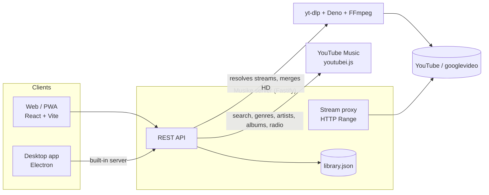

> Historical upstream documentation for [Musike](https://github.com/Ernani1234/musike), preserved for reference. For this project's version, downloads and setup, see the [project README](../README.md).

<div align="center">


# Musike

**Your music, uninterrupted.**

A personal music player for YouTube's catalog: any song or music video, as **audio** or **video**, with no ads, no account and no subscription.
Runs as a **Windows**, **macOS** and **Linux** app, as an **Android**, **Android TV** and **iPhone** app that needs no computer, in any **browser** (installable PWA) and in **Docker**.


**[Download for Windows, macOS, Linux, Android and iPhone](https://github.com/Ernani1234/musike/releases/latest)** · [Run with Docker](#option-6-docker) · [Run from source](#option-7-node-server--browser)

</div>

---

## Contents

- [What it is](#what-it-is)
- [Features](#features)
- [Screenshots](#screenshots)
- [How it works](#how-it-works)
- [Installation](#installation)
- [Moving your library (backup)](#moving-your-library-backup)
- [Keyboard shortcuts](#keyboard-shortcuts)
- [Configuration](#configuration)
- [API](#api)
- [Project structure](#project-structure)
- [Troubleshooting](#troubleshooting)
- [Roadmap](#roadmap)
- [Legal notice](#legal-notice)
- [License](#license)

## What it is

Musike started from the idea behind the old Discord music bots: a server that fetches audio straight from YouTube and hands it over ready to play. Instead of a chat, the interface is a full music player: fast, simple, and built to feel like a modern app.

- **No ads, no account:** the server gets the original stream with [yt-dlp](https://github.com/yt-dlp/yt-dlp) and passes the bytes to the player.
- **Song or music video:** switch between Audio and Video at any time, from the same point in the track. For songs, Musike finds the artist's official music video.
- **Any screen:** designed for phones of every size, tablets, laptops and big monitors.
- **Yours:** it runs on your own computer. Playlists and favorites live in a local file you can export and take to any other Musike.

## Features

**Listen**
- Search YouTube Music with **Songs**, **Videos** and **Albums** tabs, with suggestions as you type
- Paste a **YouTube link** to play it right away
- **Browse by genre:** the **Genres** button opens YouTube Music's genres (Rock, Pop, Hip-hop, Indie, Metal, Jazz…). See each genre's bands and artists (with "Load more") or all its songs in one list
- **Artists:** greatest hits, plus every album and single
- **Albums:** open any album and play it in its original order, shuffle it, or save it as a playlist in one click
- **Search a list:** type several songs separated by commas ("Bohemian Rhapsody, Hotel California, …"). Musike finds each one, picks the best match (you can swap it) and lets you play, favorite or send them all to a playlist
- Queue with play next, shuffle and repeat (queue or track)
- **Autoplay radio:** when the queue ends, it keeps going with similar songs
- Instant seeking (HTTP Range streaming) and the next track preloaded

**Video**
- Video mode in the side panel, full screen on phones, or in a floating mini player
- **Official music video** found automatically for songs (only from the artist's own channel)
- **Cinema mode:** maximize the video (button, double-click or `F`), with controls that fade while you watch, and true full screen
- SD quality (starts fast) or HD 720p (cached locally)

**Library**
- Playlists, Favorites and recently played history
- Select many tracks at once to play, favorite or add to a playlist
- **Backup to a file** to move everything to another Musike: merge or replace, with a preview before importing

**Make it yours**
- **English** and **Brazilian Portuguese**, switchable in Settings (per device). Server messages and the genre names and bios that come from YouTube Music follow the same language
- Dark and light themes, and **any accent color**: 8 presets or a custom one. Musike adjusts text shades so they stay readable in both themes
- Show or hide panels: the Now Playing panel, playlists in the sidebar, a compact icons-only sidebar, the album column, the background texture, and each section of the Home page
- Responsive from 320 px phones to ultrawide monitors; lock screen, headphone and media key controls (Media Session); picks up the queue where you left off

**Desktop app (Windows, macOS and Linux)**
- Native window with its own title bar, no browser
- Windows installer with desktop and Start menu shortcuts; macOS app for Apple Silicon and Intel; Linux `.deb` and AppImage for x64 and arm64
- Updating keeps your library (it's backed up automatically before each update)
- Downloads and maintains the tools it needs (yt-dlp, Deno, FFmpeg)

**Android and iPhone apps**
- **Standalone:** no computer, no server. The phone searches YouTube Music and plays the audio straight from YouTube
- Same app as on the computer: search, genres, artists, albums, Search a list, playlists, favorites, themes and colors
- Keeps playing with the screen off, with controls in the notification, on the lock screen and on headphones; pauses for calls and when headphones are unplugged
- **iPhone:** the same app for iOS, installed with AltStore, SideStore or Sideloadly
- **Android TV:** the same app appears in the TV launcher and switches to a bigger interface you navigate with the remote
- Audio only for now (no video mode)

**Self-hosting**
- **Docker image** for amd64 and arm64 (Raspberry Pi), with everything inside
- Open it from any device on your network, or from anywhere with Tailscale

**Maintenance**
- **Settings** shows the yt-dlp version, tells you when there's an update and updates it in one click (Stable or Nightly channel)
- Playback errors offer the "Update" button right in the notice

## Screenshots

<table>
  <tr>
    <td align="center"><br /><sub>Albums, in their original order</sub></td>
    <td align="center"><br /><sub>Browse by genre</sub></td>
  </tr>
  <tr>
    <td align="center"><br /><sub>Cinema mode</sub></td>
    <td align="center"><br /><sub>Search a list</sub></td>
  </tr>
  <tr>
    <td align="center"><br /><sub>Your colors and layout</sub></td>
    <td align="center"><br /><sub>On your phone</sub></td>
  </tr>
</table>

## How it works



1. **Catalog:** the server queries YouTube Music with [youtubei.js](https://github.com/LuanRT/YouTube.js): search, suggestions, genres, artists, albums, radio and picking the official music video.
2. **Playback:** yt-dlp resolves the stream URLs (AAC audio, MP4 video), running YouTube's player code with Deno. Those URLs are tied to the IP that resolved them, so the server **proxies** the bytes, forwarding the `Range` header so seeking is instant. Nothing is written to disk for audio.
3. **HD video and videos without an SD version:** yt-dlp downloads and merges video + audio with FFmpeg, keeps it in a cache (least-recently-played first, 2 GB by default) and the server serves the file with Range support.
4. **Library:** playlists, favorites and history live in `library.json`, written atomically.

**On Android** there is no server. The app runs Musike's server code itself (catalog and library, from `server/src`) and asks YouTube for the audio stream from the phone, so the stream URL belongs to the phone's own connection and the player reads it directly, without a proxy. Which YouTube client the app uses to get streams is read from [`mobile/streaming.json`](mobile/streaming.json), so it can be adjusted without releasing a new app.
5. **Web:** a single `<video>` element moves around the page (panel, full screen, mini player, cinema mode) without interrupting playback.

## Installation

### Option 1: Windows app

Download `Musike-Setup-<version>-Windows.exe` from the [latest release](https://github.com/Ernani1234/musike/releases/latest) and run it. The installer:

- installs for the current user only (no administrator needed) and lets you pick the folder;
- creates **Musike** shortcuts on the desktop and in the Start menu, and opens the app when it's done;
- uninstalls from Windows Settings > Apps.

On first launch, a screen shows the official tools being downloaded: **yt-dlp** and **Deno** (about 60 MB) and, in the background, **FFmpeg** (about 80 MB, for HD video). Everything lives in `%APPDATA%\Musike`:

| Folder | Contents |
|---|---|
| `bin` | Musike's own yt-dlp, Deno and FFmpeg (updatable in Settings) |
| `data` | `library.json` with playlists, favorites and history |
| `cache` | HD videos already downloaded |
| `backups` | copies of the library made at each update |

**To update, just install the new version over the old one.** `%APPDATA%\Musike` is separate from the program folder, and neither updating nor uninstalling deletes it. To be safe, the installer also copies the library to `backups\library-before-install-<version>.json` before replacing the old version, and the app keeps another dated copy on the first launch of each version (the 5 most recent). To restore one, close Musike and copy it over `data\library.json`.

> The installer isn't code-signed yet. On first run Windows shows "Windows protected your PC": click **More info**, then **Run anyway**.

To build the installer yourself: `pnpm install && pnpm installer` (creates `release\Musike-Setup-<version>-Windows.exe`).

### Option 2: macOS app

Download the `.dmg` for your Mac from the [latest release](https://github.com/Ernani1234/musike/releases/latest): `Musike-Setup-<version>-macOS-arm64.dmg` for Apple Silicon (M1 and newer) or `Musike-Setup-<version>-macOS-x64.dmg` for Intel. Open it and drag **Musike** to **Applications**. Requires macOS 12 or newer.

The app isn't notarized by Apple yet, so macOS blocks the first launch:

1. Open Musike once; macOS says it can't verify it. Click **Done**.
2. Open **System Settings > Privacy & Security**, scroll down and click **Open Anyway** next to Musike, then confirm.

If macOS says the app "is damaged and can't be opened", remove the download flag in Terminal and open it again:

```bash
xattr -dr com.apple.quarantine /Applications/Musike.app
```

Like on Windows, the first launch downloads yt-dlp, Deno and FFmpeg. Everything lives in `~/Library/Application Support/Musike` (same folders as the table above), and updating (dragging the new version over the old one) keeps your library.

To build it yourself on a Mac: `pnpm install && pnpm --filter musike-desktop dist:mac` (creates the `.dmg` files in `release`).

### Option 3: Linux app

From the [latest release](https://github.com/Ernani1234/musike/releases/latest), pick the package for your system: `x64` for most PCs, `arm64` for ARM computers such as a Raspberry Pi 4 or 5 running a 64-bit desktop.

- **Debian, Ubuntu, Linux Mint, Pop!_OS:** `Musike-Setup-<version>-Linux-x64.deb`. Open it with the software installer, or run `sudo apt install ./Musike-Setup-<version>-Linux-x64.deb`. Musike appears in the applications menu.
- **Any other distribution:** `Musike-Setup-<version>-Linux-x64.AppImage`. Make it executable and run it: `chmod +x Musike-*.AppImage && ./Musike-*.AppImage`.

> Ubuntu 24.04 and newer block the sandbox an AppImage needs, so there the AppImage closes right away: use the `.deb` (it sets up what's needed), or start the AppImage with `--no-sandbox`.

Like on Windows and macOS, the first launch downloads yt-dlp, Deno and FFmpeg. Everything lives in `~/.config/Musike` (same folders as the table above). To update, install the new `.deb` over the old one or replace the AppImage: your library stays.

To build it yourself on Linux: `pnpm install && pnpm --filter musike-desktop dist:linux` (creates the `.deb` and `.AppImage` files in `release`).

### Option 4: Android app

On the phone, download `Musike-Setup-<version>-Android.apk` from the [latest release](https://github.com/Ernani1234/musike/releases/latest) and open it. Android asks to allow installing apps from your browser (or Files): allow it, then tap **Install**. If Play Protect warns about an unknown app, tap **More details > Install anyway**. Requires Android 7.0 or newer.

- It works on its own: no computer and no Musike server needed, only an internet connection.
- Your playlists and favorites live on the phone. To move them to or from a computer, use [backup to a file](#moving-your-library-backup) (on Android, Export opens the share sheet: save to Files or Drive, or send it to yourself).
- **To update,** install the new APK over the old one. Your library stays.
- Audio only for now: the video mode is available on the desktop app and in the browser.
- **Android TV:** install the same APK on the TV (for example with a file manager app, or `adb install`). Musike shows up in the TV launcher and switches to a remote-friendly interface by itself.

To build the APK yourself you need JDK 21 and the Android SDK (Android Studio installs both): `pnpm install && pnpm --filter @musike/mobile apk` (creates `release/Musike-Setup-<version>-Android.apk`; unsigned unless `mobile/android/keystore.properties` points to your signing key).

### Option 5: iPhone app

Download `Musike-Setup-<version>-iOS.ipa` from the [latest release](https://github.com/Ernani1234/musike/releases/latest). Apple only lets App Store apps install directly, so the file comes unsigned and is signed with your own Apple ID as you install it, using one of these free tools:

- **AltStore** or **SideStore:** install the store on the iPhone, then open the `.ipa` with it.
- **Sideloadly:** on a Windows or Mac computer, connect the iPhone and drag the `.ipa` into it. Then trust your Apple ID in **Settings > General > VPN & Device Management**.

On iOS 16 and newer, also turn on **Settings > Privacy & Security > Developer Mode** the first time. With a free Apple ID the app has to be signed again every 7 days; AltStore and SideStore do it on their own in the background. Requires iOS 15 or newer.

Like on Android, it works on its own (no computer or server), keeps playing with the screen locked, and has controls on the lock screen, in Control Center and on headphones. Audio only for now.

To build it yourself on a Mac with Xcode: `pnpm install && pnpm --filter @musike/mobile ipa` (creates `release/Musike-Setup-<version>-iOS.ipa`).

### Option 6: Docker

For a home server, NAS or Raspberry Pi. The image (amd64 and arm64) includes yt-dlp, Deno and FFmpeg.

```yaml
# docker-compose.yml
services:
  musike:
    image: ghcr.io/ernani1234/musike:latest
    ports:
      - "4180:4180"
    volumes:
      - musike-data:/data   # library: playlists, favorites, history
      - musike-cache:/cache # HD videos already downloaded
    restart: unless-stopped
volumes:
  musike-data:
  musike-cache:
```

```bash
docker compose up -d   # then open http://<that machine>:4180
```

Or with plain Docker: `docker run -d -p 4180:4180 -v musike-data:/data -v musike-cache:/cache ghcr.io/ernani1234/musike`. To build the image from source instead: `docker build -t musike .`

- A new image is published for every release; `docker compose pull && docker compose up -d` updates it. The library stays in the `/data` volume.
- yt-dlp can also be updated from **Settings** without a new image (until the container is recreated).
- All the [environment variables](#configuration) work, e.g. `YTDLP_EXTRA_ARGS="--cookies /data/cookies.txt"` for YouTube's bot checks.

> **Run it at home, not on a VPS:** YouTube blocks datacenter IPs ("Sign in to confirm you're not a bot"). A home server uses your residential IP.

### Option 7: Node server + browser

Requirements:

| Tool | Version | Windows |
|---|---|---|
| Node.js | 22.19+ | `winget install OpenJS.NodeJS.LTS` |
| pnpm | 10+ | `corepack enable` |
| yt-dlp | recent | `winget install yt-dlp.yt-dlp` (installs Deno and FFmpeg too) |

```bash
pnpm install
pnpm build   # builds the web app
pnpm start   # http://localhost:4180
```

The server prints its network addresses on start. Open the `Network:` address on a phone on the same Wi-Fi (allow Node through the firewall on private networks). On Windows the server finds yt-dlp even in terminals opened before it was installed, by reading the PATH from the registry.

**Away from home:** install [Tailscale](https://tailscale.com) on the computer and the phone. To install Musike as an app (PWA) on the phone the browser requires HTTPS: run `tailscale serve --bg 4180` and use the `https://...ts.net` address.

### Development

```bash
pnpm dev        # server (4180) + Vite with hot reload (5173)
pnpm desktop    # opens the Electron app in development mode
pnpm typecheck  # checks every package
```

## Moving your library (backup)

Until cloud sync exists, Musike exports everything to a file that **any instance** can read: web, desktop, Android, Docker, another computer.

1. On the source, open **Settings > Your data > Export** (or the database icon in the Library). A `musike-backup-YYYY-MM-DD.musike.json` file is saved (on Android, the share sheet opens so you can save or send it).
2. On the destination, **Settings > Your data > Import** and pick the file.
3. Check the preview (how many playlists, tracks, favorites) and choose:
   - **Merge with my library** (default): adds what's missing and never deletes. Playlists with the same name get the new tracks; importing twice duplicates nothing.
   - **Replace everything:** makes the library exactly like the backup (asks for confirmation).
4. Optionally, also apply the appearance, language and player preferences.

The file is readable, versioned JSON:

```json
{
  "format": "musike-backup",
  "version": 1,
  "exportedAt": "2026-10-16T22:33:00.000Z",
  "app": "Musike 1.4.0",
  "library": {
    "favorites": [{ "id": "hTWKbfoikeg", "title": "Smells Like Teen Spirit", "artist": "Nirvana", "duration": 302, "thumb": "https://...", "art": "https://...", "kind": "song" }],
    "playlists": [{ "id": "…", "name": "Focus", "createdAt": 1791842422955, "updatedAt": 1791842422955, "tracks": [] }],
    "history": []
  },
  "settings": { "theme": "dark", "lang": "en", "preferVideo": false, "quality": "sd", "autoRadio": true, "volume": 0.9 }
}
```

On import the server validates every track (YouTube ID, sizes, `https://` images only), skips invalid entries instead of rejecting the whole file, and refuses backups from newer versions with a clear message.

## Keyboard shortcuts

| Key | Action |
|---|---|
| `Space` | Play / pause |
| `←` `→` | Back / forward 5 s |
| `Shift` + `←` `→` | Previous / next track |
| `↑` `↓` | Volume |
| `M` | Mute |
| `L` | Favorite the current track |
| `S` | Shuffle |
| `R` | Repeat (off, queue, track) |
| `V` | Switch Audio / Video |
| `F` | Cinema mode |
| `Q` | Queue |
| `/` | Search |
| `?` | Shortcut list |

## Configuration

Server environment variables (all optional):

| Variable | Default | Use |
|---|---|---|
| `PORT` | `4180` | HTTP port |
| `HOST` | `0.0.0.0` | Use `127.0.0.1` to accept only this computer |
| `YTDLP_PATH` | automatic | Forces a specific yt-dlp executable |
| `YTDLP_EXTRA_ARGS` | | Extra flags, e.g. `--cookies-from-browser firefox` |
| `MUSIKE_DATA_DIR` | `server/data` (`/data` in Docker) | Where `library.json` lives |
| `MUSIKE_CACHE_DIR` | `server/cache` (`/cache` in Docker) | Downloaded HD videos |
| `MUSIKE_CACHE_MAX_MB` | `2048` | Video cache limit (least recently played go first) |
| `MUSIKE_BIN_DIR` | | Private tools folder (the desktop app uses `%APPDATA%\Musike\bin`) |
| `MUSIKE_LANG` | `en` | YouTube Music language when a request doesn't say (the app always sends the chosen language) |
| `MUSIKE_LOCATION` | `BR` | Region for YouTube Music results |

## API

Every route answers JSON. Errors look like `{ "error": "message", "code"?: "tool_missing" | "maybe_outdated" | "bot_check" }`, with the message in the language of the `x-musike-lang` request header (`en` or `pt-BR`).

| Method | Route | Description |
|---|---|---|
| `GET` | `/api/search?q=&type=song\|video` | Search YouTube Music |
| `GET` | `/api/search/albums?q=` | Search albums |
| `GET` | `/api/suggest?q=` | Search suggestions |
| `GET` | `/api/radio/:id` | Related tracks (radio) |
| `GET` | `/api/genres` | YouTube Music genres |
| `GET` | `/api/genres/:gid` | A genre's artists and songs |
| `GET` | `/api/genres/:gid/artists?offset=` | More of a genre's artists ("Load more") |
| `GET` | `/api/artists/:aid` | An artist's greatest hits, albums and singles |
| `GET` | `/api/albums/:alid` | An album's tracks in order |
| `GET` | `/api/video-for/:id?title=&artist=&duration=` | A song's official music video |
| `POST` | `/api/prepare/:id` | Resolves a stream before playing |
| `GET` | `/api/stream/:id/audio` | Audio with HTTP Range |
| `GET` | `/api/stream/:id/video?q=sd\|hd` | Video with HTTP Range |
| `GET` | `/api/library` | The whole library |
| `PUT` / `DELETE` | `/api/favorites/:id` | Favorite / unfavorite |
| `POST` | `/api/favorites` | Favorite many at once (`{ tracks }`) |
| `POST` | `/api/history` | Records a played track |
| `POST` | `/api/playlists` | Creates a playlist |
| `PATCH` / `DELETE` | `/api/playlists/:pid` | Renames / deletes |
| `POST` / `DELETE` | `/api/playlists/:pid/tracks[/:id]` | Adds (one track or `{ tracks }`) / removes a track |
| `POST` | `/api/library/import` | Imports a backup (`{ backup, mode: "merge" \| "replace" }`) |
| `GET` | `/api/system` | yt-dlp, Deno and FFmpeg versions and downloads |
| `POST` | `/api/system/ytdlp` | Updates or installs yt-dlp (`{ channel: "stable" \| "nightly" }`) |

## Project structure

```
musike/
├─ server/            Fastify + yt-dlp + youtubei.js
│  └─ src/
│     ├─ app.ts         routes and startup (used by the CLI, the desktop app and Docker)
│     ├─ browse.ts      genres, artists, albums
│     ├─ search.ts      search, suggestions, radio and official music videos
│     ├─ ytdlp.ts       stream resolution, HD cache, error messages
│     ├─ stream.ts      proxy with HTTP Range
│     ├─ library.ts     playlists, favorites, history and backup import
│     ├─ i18n.ts        server messages in each language
│     ├─ tools.ts       finds yt-dlp, Deno, FFmpeg (Windows registry, winget, PATH)
│     ├─ bootstrap.ts   downloads the tools for the desktop app
│     └─ system.ts      yt-dlp version and updates
├─ web/               React 19 + Vite + Tailwind v4 + Motion + Phosphor (PWA)
│  └─ src/
│     ├─ player/        playback engine (audio, video, queue, Media Session)
│     ├─ components/    player, panels, cinema mode, Settings, backup
│     ├─ views/         Home, Search, Library, playlists, genres, artists, albums
│     ├─ i18n/          English (the source) and Portuguese
│     ├─ native/        Android: server code running in the app, streams, media controls
│     ├─ tv/            Android TV: remote (D-pad) navigation and the 10-foot interface
│     └─ stores/        state (zustand), appearance preferences
├─ desktop/           Electron: window, built-in server, Windows installer, macOS and Linux packages
├─ mobile/            Android and iOS apps (Capacitor): native playback, signing, streaming.json
├─ Dockerfile         server + web app image (amd64, arm64)
└─ docs/              UX benchmark, design system and screenshots
```

**Stack:** TypeScript everywhere · Fastify 5 · youtubei.js · yt-dlp · React 19 · Vite 8 · Tailwind CSS 4 · Motion · Zustand · React Router · Phosphor Icons · Geist · Electron 44 · electron-builder · Capacitor 8.

**Design:** the identity (the equalizer M mark, the Volt color, Geist) and the layout rules are in [docs/design-system.md](docs/design-system.md). The UX study behind the layout is in [docs/ux-benchmark.md](docs/ux-benchmark.md).

**Adding a language:** copy `web/src/i18n/pt.ts`, translate it (TypeScript fails the build if a key is missing), list it in `web/src/i18n/index.ts`, and add the server messages in `server/src/i18n.ts`.

## Troubleshooting

**Songs stopped playing, or "YouTube refused the stream"**
YouTube changes often and yt-dlp keeps up. Open **Settings** and click **Update**. If the fix hasn't reached the Stable channel yet, pick **Nightly**.

**"YouTube is asking this connection to prove it's not a bot"**
YouTube asks this of some connections, mostly VPNs and shared networks (offices, universities, some providers). Musike first tries to get the audio another way, so you only see this message when that fails too.

- If you use a VPN, turn it off and try again.
- Running the server yourself, you can pass cookies from a signed-in browser (Firefox works best on Windows). YouTube may flag an account used this way, so prefer one you don't mind losing:

```bash
YTDLP_EXTRA_ARGS="--cookies-from-browser firefox" pnpm start
```

In Docker, export a `cookies.txt` into the data volume and set `YTDLP_EXTRA_ARGS="--cookies /data/cookies.txt"`.

**"yt-dlp wasn't found"**
In the desktop app, use **Install** in Settings. For the Node server, install it with `winget install yt-dlp.yt-dlp` or set `YTDLP_PATH`.

**Video takes a while to start**
Many videos have no combined SD version; the server downloads and merges video and audio before playing (a few seconds the first time, instant after that thanks to the cache).

**"This song has no music video on YouTube"**
Musike only accepts music videos from the artist's own channel, so it never plays covers or wrong versions. The song keeps playing as audio.

**iPhone**
iOS limits background playback for PWAs; Audio mode works better than Video.

## Roadmap

- [x] Albums and artist discographies
- [x] Docker image
- [x] Languages and appearance settings
- [x] macOS app
- [x] Linux app
- [x] Android app (audio)
- [x] iPhone app (audio, sideloaded)
- [ ] Cloud sync for the library (today: [backup to a file](#moving-your-library-backup))
- [ ] Import YouTube playlists from a link
- [ ] Video mode on Android
- [ ] Automatic updates for the desktop app

Ideas and bug reports are welcome in [Issues](https://github.com/Ernani1234/musike/issues).

## Legal notice

Musike is a project for **personal and educational use**. Playing YouTube content without ads by extracting its streams goes against [YouTube's Terms of Service](https://www.youtube.com/t/terms); public services that did this, such as the Groovy and Rythm bots, were shut down after notices from Google. Don't offer Musike as a public service, don't monetize it, and respect the artists' rights. The project doesn't host, distribute or store YouTube content beyond the temporary local cache of whoever runs it.

## License

[MIT](LICENSE) © 2026 Ernani Neto
